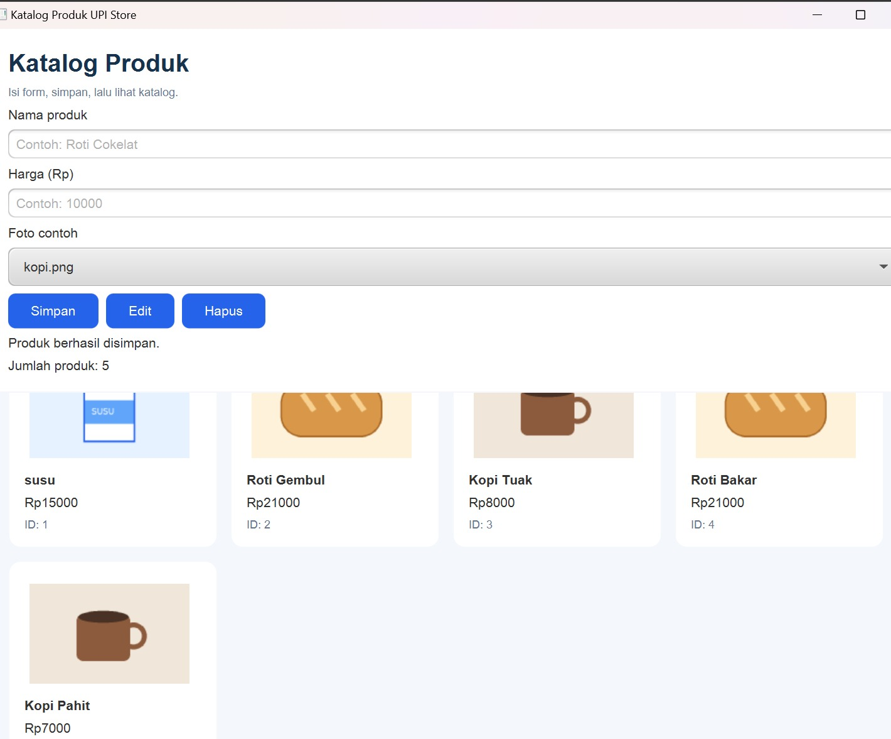
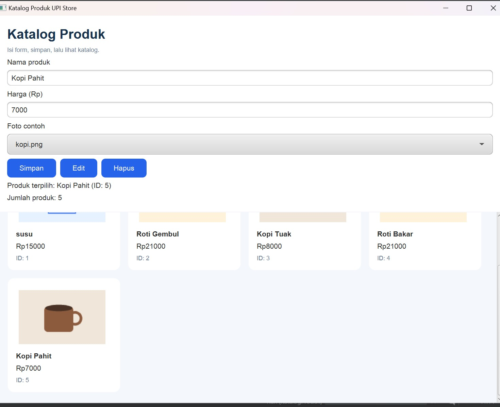
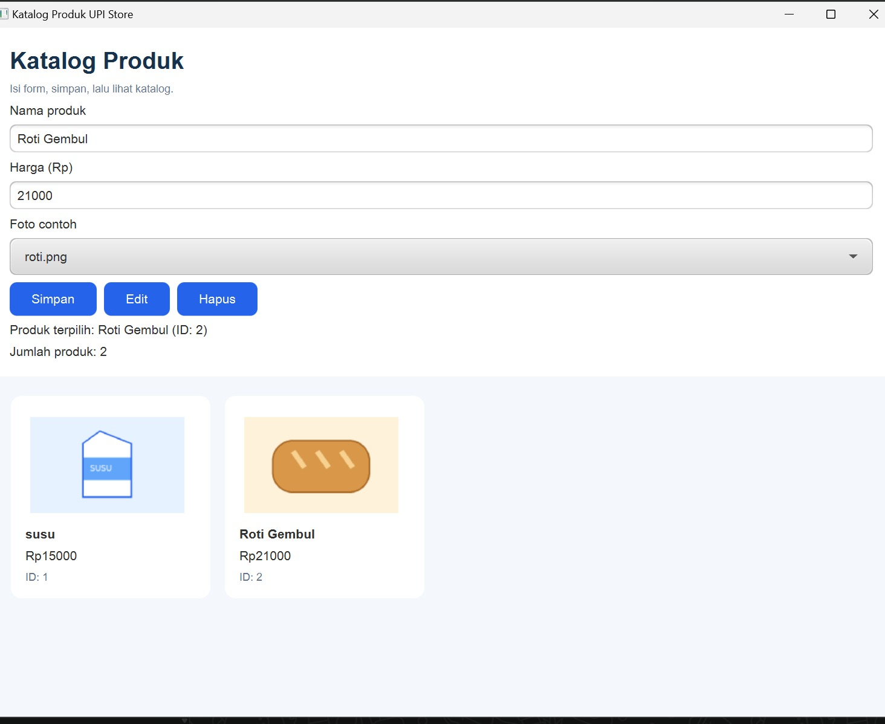

# KatalogProdukJavafx

Aplikasi desktop **Katalog Produk** berbasis **JavaFX**, **Maven**, dan **SQLite** dengan arsitektur **MVC** (`model`, `data`, `controller`, dan `view`). Aplikasi ini mengelola data produk secara persisten dan menampilkannya sebagai kartu produk di dalam `TilePane`.

## Fitur Utama
- **Tambah Produk (Create)**: Mengisi nama produk, harga (Rp), dan foto contoh, lalu klik **Simpan** untuk menyimpannya ke database SQLite.
- **Lihat Katalog (Read)**: Menampilkan seluruh daftar produk dalam bentuk kartu di `TilePane` beserta total jumlah produk.
- **Edit Produk (Update)**: Klik salah satu kartu produk untuk memuat datanya ke form, ubah nilai yang diinginkan, lalu klik **Edit** untuk memperbarui data di database.
- **Hapus Produk (Delete)**: Klik kartu produk yang dipilih lalu klik **Hapus** untuk menghapus data produk dari database dan memperbarui tampilan katalog.

## Cara Menjalankan
1. Pastikan **JDK** dan **Apache Maven** sudah terpasang.
2. Buka folder proyek di IDE (seperti Apache NetBeans) atau terminal.
3. Jalankan perintah Maven:
   ```bash
   mvn javafx:run

## Screenshot Aplikasi

### 1. Tambah Produk


### 2. Pilih & Edit Produk


### 3. Hapus Produk & Pembaruan Katalog

